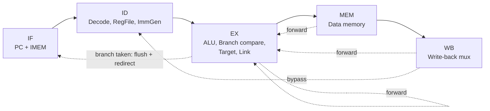
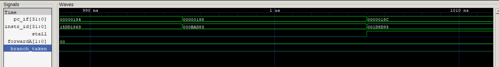

# 5-Stage Pipelined RISC-V (RV32I) CPU

A classic five-stage pipelined processor implementing the complete **RV32I** base integer instruction set, written in Verilog and verified with a self-checking assembly test suite in Icarus Verilog.

```
IF  ->  ID  ->  EX  ->  MEM  ->  WB
```

## Features

- **Full RV32I:** arithmetic, logic, shifts, `SLT`/`SLTU`, `LUI`, `AUIPC`, `JAL`, `JALR`, all six branches (`BEQ BNE BLT BGE BLTU BGEU`)
- **Sub-word memory access:** `LB LH LW LBU LHU SB SH SW` with correct alignment and sign/zero extension
- **Hazard handling**
  - Data forwarding from EX/MEM and MEM/WB into EX (newest producer wins)
  - Load-use stall (1 bubble)
  - Register-file write-before-read bypass (WB to ID in the same cycle)
- **Control hazards:** branches and jumps resolve in EX with a dedicated comparator; a taken branch flushes the two wrong-path instructions (2-cycle penalty)
- `FENCE`, `ECALL`, `EBREAK` decode as NOPs
- Parameterized instruction memory (hex file and depth)

## Pipeline overview



Load-use hazards are detected in ID (`hazard_unit`), which holds the PC and IF/ID register for one cycle and inserts a bubble into ID/EX.

## Waveform highlights



Captured from the simulation: EX/MEM forwarding (`forwardA = 10`), a one-cycle load-use stall (PC and IF/ID held, bubble inserted into EX), and a taken branch flushing the wrong-path instructions. The testbench also writes `cpu.vcd`, which can be opened in GTKWave.

## Repository layout

```
rtl/cpu.v           All RTL modules (single file, top module: cpu)
tb/tb.v             Testbench: runs the program, reports PASS/FAIL, dumps cpu.vcd
docs/               Waveform figure used in this README
tests/test.S        Self-checking RV32I assembly test program
tests/instr_mem.hex Assembled program (loaded by the instruction memory)
tests/run.sh        Rebuilds the hex from test.S and runs the simulation
```

## Running the simulation

Requires [Icarus Verilog](https://bleyer.org/icarus/) (`-g2012`).

```
cd tests
iverilog -g2012 -o sim ../tb/tb.v ../rtl/cpu.v
vvp sim
```

Expected output:

```
PASS  (243 cycles)
```

A harmless warning about `$readmemh` appears because the program is shorter than the 1024-word memory; the rest is filled with NOPs.

To modify the test program, install the RISC-V GNU toolchain (`riscv64-unknown-elf-gcc`) and run `sh run.sh` from `tests/` (Linux/WSL).

## Verification

`test.S` is a self-checking program: each check compares a result against its expected value and, on mismatch, records the failing test number and halts. The testbench reports `PASS` or `FAIL test #N`.

Coverage includes:

- Every ALU operation, including arithmetic vs. logical right shifts and signed vs. unsigned compares
- Back-to-back RAW dependencies (EX/MEM forwarding) and dependencies three instructions apart (register-file bypass)
- Load-use stalls, and a load feeding a store's data
- Byte/half/word loads and stores with sign and zero extension, including read-modify-write on partial words
- All six branches, both taken and not taken, plus a check that wrong-path instructions never commit
- `JAL`/`JALR` link values, including a `JALR` target with an odd low bit
- A loop (sum of 1..10)

## Bugs found and fixed

This design started as a working-but-flawed pipeline. Debugging it produced the following fixes:

| Bug                                                                                          | Symptom                                            | Fix                                                               |
| -------------------------------------------------------------------------------------------- | -------------------------------------------------- | ----------------------------------------------------------------- |
| `ADDI` with a negative immediate executed as `SUB` (ALU control read `instr[30]` for I-type) | Wrong results for any `addi rd, rs, -n`            | Only R-type may use `funct7[5]` to select `SUB`                   |
| `JAL`/`JALR` never wrote `PC+4` to `rd`                                                      | Calls and returns broken                           | Link value muxed into the EX result so it also forwards correctly |
| `JALR` target computed as `pc + imm`                                                         | Wrong jump address                                 | `(rs1 + imm) & ~1`, using forwarded `rs1`                         |
| Only `BEQ`/`BNE` supported, using the ALU zero flag                                          | `BLT/BGE/BLTU/BGEU` ignored                        | Dedicated comparator on forwarded operands                        |
| No register-file bypass                                                                      | Stale read when producer is 3 instructions earlier | Write-before-read bypass in the register file                     |
| Word-only loads and stores                                                                   | `LB/LH/LBU/LHU/SB/SH` missing                      | Byte-lane aware memory stage                                      |
| `LUI`/`AUIPC` used the wrong operand                                                         | Wrong upper-immediate results                      | Explicit operand-A select (zero / PC / `rs1`)                     |
| Hazard unit stalled on `rd == x0`                                                            | Unnecessary stall cycles                           | Ignore `x0` dependencies                                          |

## Possible next steps

- Synchronous-read memories for BRAM inference on FPGA
- RV32M extension (multiply/divide)
- Branch prediction to reduce the taken-branch penalty
- CSR and trap support
- Synthesis results (LUT count, Fmax) on a target FPGA

## Author

Ayaz Sheikh — [GitHub](https://github.com/Ayaz17S)
